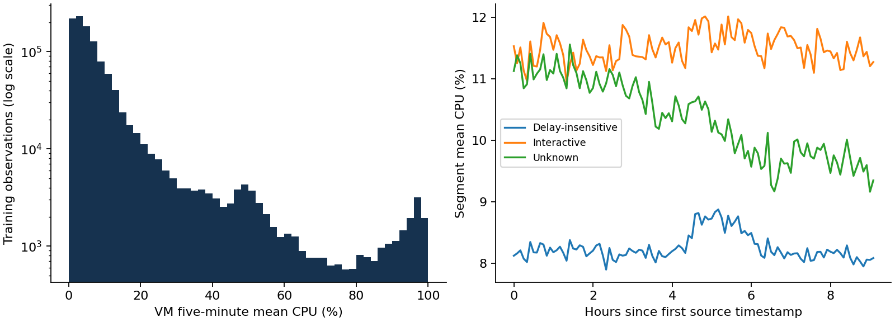
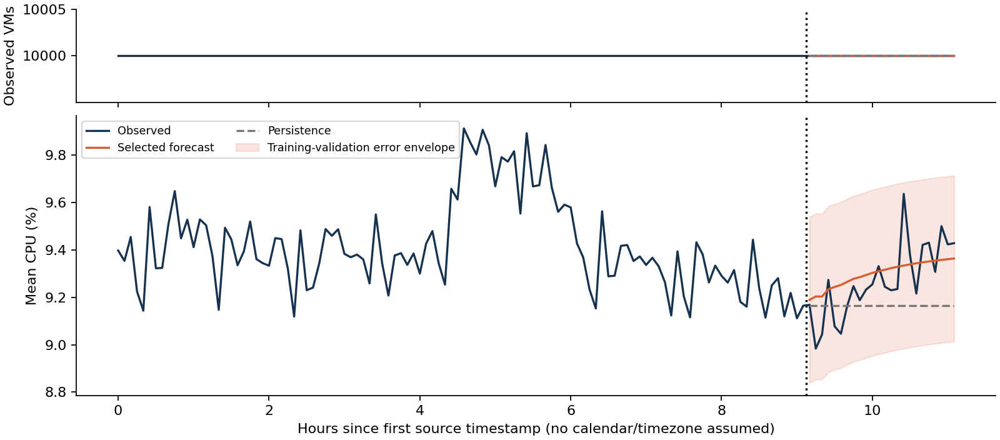

# Cloud workload forecasting

## 1. Executive summary and scope

The useful forecasting signal in this release is small aggregate CPU movement, while individual VMs have a much broader utilization distribution. A lightweight ridge autoregression beats persistence on mean CPU error in the final two-hour test. The evidence supports an advisory forecast for this selected population; it does not establish daily demand patterns or justify autonomous fleet downsizing.

| Final holdout | Persistence | Selected model |
|---|---:|---:|
| CPU MAE, percentage points | 0.1468 | 0.0987 |
| CPU RMSE, percentage points | 0.1848 | 0.1203 |
| CPU sMAPE, percent | 1.5851 | 1.0646 |
| Active VM MAE, VMs | 0 | 0 |

CPU MAE improves by 32.7% and RMSE by 34.9%. CPU model selection used only chronological validation inside the first 110 observations and selected a six-lag ridge autoregression. VM count selected persistence by a simplicity tie-break. Predictions were saved before a separate command accessed holdout labels for scoring. All 24 required timestamps are present, from source second 33,000 to 39,900.

The apparent success on VM count has a structural explanation: the release deliberately includes VMs with complete traces. The observed count stays at 10,000. A model cannot demonstrate learning arrivals or departures on a population selected to exclude them. This matters more operationally than the perfect score.

The final test contains no CPU values above the training 90th percentile. It is therefore a comparatively mild test, not evidence of reliability during extreme load. Earlier validation windows expose peak underprediction and a window where the selected model loses to persistence. These weaknesses are retained in the analysis.

Recommended use is a two-hour demand advisory, refreshed every five minutes, with a 0.350 percentage-point empirical error margin and separate hot-VM, latency and queue safeguards. The margin is a descriptive validation error envelope, not a guaranteed coverage interval. Unweighted VM CPU cannot be translated into physical cores without capacity weights and placement data.

Reproduction requires the fixed public data-v1 release and Python 3.11+. The repository includes a single prediction command, input checks, audit artifacts, a separate evaluation command, and tests that verify predictions are unchanged when holdout labels change. AI assistance supported implementation, analysis and writing; the candidate should be able to explain and defend the result.

---

## 2. Data understanding and target construction

The SHA-256-verified release contains 1,340,000 CPU rows, 10,000 distinct VMs and 134 global timestamps. Source time runs from 0 to 39,900 seconds, an elapsed 11.083 hours. Each VM has 134 readings with all 133 inter-observation differences equal to 300 seconds. There are no missing CPU fields, duplicate VM/timestamp pairs, invalid CPU ranges or global timestamp gaps. Metadata has exactly one matching record per VM.

The required targets are constructed before splitting. Active VM count is the number of distinct VMs with a valid CPU observation at a timestamp. Aggregate utilization is the arithmetic mean of their five-minute average CPU readings. This is an unweighted percentage, not a sum, maximum, or core-weighted utilization. Count and CPU describe the represented population, not every VM in Azure.

The implementation rejects missing values, duplicate observations, nonfinite values, CPU values outside [0,100], min/mean/max ordering violations, metadata mismatch and global grid gaps. It does not invent measurements through filling. This strict policy suits the complete challenge release; production ingestion would instead quarantine defects and publish coverage separately. If valid records for some VMs are absent while a global timestamp remains, the target uses those actually represented, per contract. A population change could mimic a demand change.

Observed arrivals and departures inside the release are both zero. All selected VMs have metadata creation times at or before the first reading, and none has a metadata deletion time within the observed window. The median recorded lifetime is about 719.8 hours, and the shortest is 11.25 hours. A large mass at the source trace boundary makes these lifecycle intervals censored descriptions, not estimates of natural survival or remaining lifetime.

The data card specifies complete-trace eligibility and deterministic stratification by category and core bucket. This induces survivorship and selection bias. A stratified sample is not a fleet inventory, and its equal-VM average is not necessarily an unbiased Azure-wide estimate. The dataset cannot validate VM creation, deletion, or bursty fleet growth.

Times are seconds relative to a source trace. No calendar date, timezone, weekday or working-hours assumptions are introduced. Source metadata CPU summaries, deletion times and workload categories may reflect information beyond a forecast origin. They are excluded from model inputs. Categories and size buckets are used only to describe segments; no segment-based forecasting choice depends on them.

---

## 3. Workload analysis and operational meaning

Distribution and segment statistics below use only the first 110 timestamps: 1,100,000 VM observations. Mean CPU is 9.414%, median 5.120%, P95 37.293%, and P99 87.406%. About 1.272% of observations reach at least 80%. The wide upper tail means a reassuring fleet average can coexist with individual hot VMs and placement constraints.

| Category | VMs | Mean CPU % | P95 CPU % | Aggregate std, pp |
|---|---:|---:|---:|---:|
| Delay-insensitive | 6,180 | 8.257 | 25.940 | 0.217 |
| Interactive | 3,091 | 11.505 | 49.147 | 0.243 |
| Unknown | 729 | 10.355 | 52.498 | 0.629 |

Interactive VMs have higher mean CPU and about twice the frequency of >=80% readings as delay-insensitive VMs (1.912% versus 0.892%). Protect latency-sensitive work within that segment rather than inferring safety from the overall mean. Delay-insensitive VMs contribute 5.103 percentage points to the overall 9.414% mean because they dominate the sample. The small unknown segment has the most variable aggregate and merits separate monitoring.

Size-bucket results are in segments.csv. The 2-core bucket has 7,534 VMs; the >24-core bucket has only 10 and an aggregate CPU standard deviation of 2.003 pp. This noisy small segment should not set fleet-wide thresholds. The 4-GB memory bucket has more >=80% readings (3.266%) than the 2-GB bucket (0.604%). These are associations, not causal effects.

Training aggregate CPU ranges from 9.112% at second 32,400 to 9.912% at second 16,500. A broad elevated region around hours 4.5-6 contrasts with a declining unknown segment. Lag correlations are 0.667 at five minutes, 0.477 at thirty minutes, 0.367 at one hour and -0.026 at two hours. These suggest short persistence and changing level; the window cannot establish daily recurrence.

---

## 4. Forecasting approach and validation protocol

Five-minute cadence is retained because the targets are cheap to model and the deliverable requires five-minute forecasts. The first 110 timestamps form the public training window; the final 24 are reserved for test. Model fitting, feature engineering and selection receive only training targets. Future timestamp positions are known from the fixed grid.

Expanding-window validation origins follow 38, 62 and 86 observations. Each predicts a full 24-step block: indices 38-61, 62-85 and 86-109, zero based. Validation targets are disjoint. Later folds legitimately include earlier validation observations as newly available history. The blocks mimic a forecast issued once and left unupdated for two hours. Errors remain serially dependent despite disjoint blocks.

Seven candidates were declared: persistence; trailing means of 6, 12 and 24 readings; all-history mean; a damped twelve-reading local trend; and ridge autoregression with six lags. Mean windows test noise reduction versus response delay. Trend damping is fixed at 0.8. AR fits the next standardized target from the previous six standardized values, with ridge penalty 10 and an unpenalized intercept. Six lags cover thirty minutes, limiting parameter count in short folds. Scaling uses only each fold's history.

For multi-step AR forecasts, predicted values feed later lag inputs. Actuals from the forecast horizon never feed back. CPU is clipped to [0,100] and count to nonnegative values for all candidates and folds. Lowest pooled validation MAE selects a model per target, with baseline-first numerical tie breaking. No penalty or lag search followed inspection of the final test.

| CPU candidate | Validation MAE, pp | Validation RMSE, pp |
|---|---:|---:|
| Persistence | 0.2082 | 0.2684 |
| Mean of last 6 | 0.2140 | 0.2690 |
| Mean of last 12 | 0.1784 | 0.2322 |
| Mean of last 24 | 0.2077 | 0.2496 |
| All-history mean | 0.1912 | 0.2342 |
| Damped local trend | 0.2532 | 0.3285 |
| Ridge AR(6), selected | 0.1710 | 0.2143 |

Ridge improves validation MAE by 17.9%, but its margin over a one-hour mean is small. Three blocks cannot establish statistical superiority. Daily seasonal-naive, neural networks and rich calendar features lack defensible seasonal history here. A regularized linear model adds modest structure with an auditable information boundary.

---

## 5. Results, peak behavior and failure analysis

Final CPU MAE is 0.0987 pp and RMSE 0.1203; the MAE/persistence-MAE ratio is 0.6727. Signed bias is +0.0301 pp. VM error is zero for both methods, so relative improvement is undefined and recorded as null. sMAPE uses max(|actual|+|prediction|, 1e-8) in the denominator; both zero gives zero. CPU percentage-point errors remain the main interpretable measure.

CPU fold MAEs for ridge versus persistence are 0.1895 versus 0.1947, 0.1352 versus 0.2975, and 0.1882 versus 0.1324. The last fold is a real failure: shrinkage and recursive mean reversion retain too high a level after demand declines. The selected method was left unchanged after test scoring.

Peak thresholds are the 90th percentile of each origin's training history. In block one, ten timestamps exceed it; ridge peak MAE is 0.3628 pp versus persistence 0.3904. In block two, six exceed it; ridge peak MAE is 0.1418 versus persistence 0.0730. No peaks qualify in block three. Better average error can still accompany worse high-load performance.

The full-training threshold is 9.6684%. No final test observation reaches it, so test peak MAE is unavailable, not zero. The largest test CPU is 9.6360% at second 37,500. Ridge predicts 9.3338%, underpredicting by 0.3022 pp; persistence misses by 0.4714. The earlier training surge is harder: at origin 38 the worst ridge underprediction is 0.5151 pp.

Validation MAE is 0.1224 pp at minutes 5-30, 0.0812 at 35-60, 0.2127 at 65-90 and 0.2676 at 95-120. Longer horizons tend to be harder. The pooled 90th-percentile absolute validation error is 0.3496 pp; its symmetric envelope covers all 24 test CPU observations. Selection reuse, few blocks and temporal dependence preclude a calibrated 90% guarantee. Count's zero-width envelope reflects selection, not zero production risk.

---

## 6. Capacity recommendation, limits and reproduction

Use an advisory policy before automating resource actions. Every five minutes, forecast the next two hours and compute the maximum CPU forecast plus 0.3496 pp, clipped to 100%. Compare this upper scenario to the prior-history 90th percentile (9.6684% here). The maximum point forecast is 9.3633%; its upper scenario is 9.7129%, flagging elevated aggregate-demand risk. Margin and threshold derive from training; neither is tuned to the test.

When flagged, check segment utilization, per-VM saturation, latency, queue depth and scheduling lead time. If these confirm pressure, pre-warm reversible capacity or postpone delay-insensitive work. Retain reactive saturation safeguards; require sustained service-level evidence before releasing headroom. Re-forecasting every five minutes is a proposed deployment policy; only fixed-origin two-hour forecasts were evaluated.

A larger margin increases standby cost and false alerts but reduces missed pressure. A smaller margin saves resources while making spikes more costly. The mild test triggers risk despite containing no training-defined peaks, illustrating possible conservatism. Costs, service-level targets and scale-up delay are absent, so this is a pilot heuristic, not an optimal controller. Backtest alert precision, lead time, missed peaks and resource cost across independent days before activation.

Unweighted VM percentages cannot determine physical core demand. Core buckets include open-ended values, sizes differ, and placement, CPU frequency and oversubscription are unknown. Actual capacity planning needs exact allocatable cores, core-weighted utilization and scheduler constraints. Adding a fixed number of VMs is not justified by this constant sampled count. Measure arrivals, departures and telemetry coverage on an uncensored population first.

Next priorities are several weeks of comparable data, independent-day rolling validation and segment peak errors. Then compare seasonal-naive and regularized segment models, and calibrate one-sided errors on a separate period. Add coverage monitoring, drift detection and a persistence fallback before evaluating business costs. Current results do not establish daily seasonality, fleet churn prediction, calibrated uncertainty or transfer to other clouds.

Reproduce with `python -m cwfc.download`, then `python -m cwfc.predict`. Only after predictions are frozen run `python -m cwfc.evaluate` and `python -m cwfc.analyze`. selection.json records training/prediction hashes, environment versions and all validation MAEs. Tests include a holdout-label perturbation test and tiny custom data. Code and generated tables provide a notebook-equivalent analysis.

Sources: Atomity ASSIGNMENT.md, DATASET.md, SUBMISSION.md and verified data-v1 DATA_CARD.md; Microsoft Azure Public Dataset V2 (https://github.com/Azure/AzurePublicDataset). All numerical results were calculated from this release. No upstream reconstruction, private data, additional labels or claimed personal project history was used.
